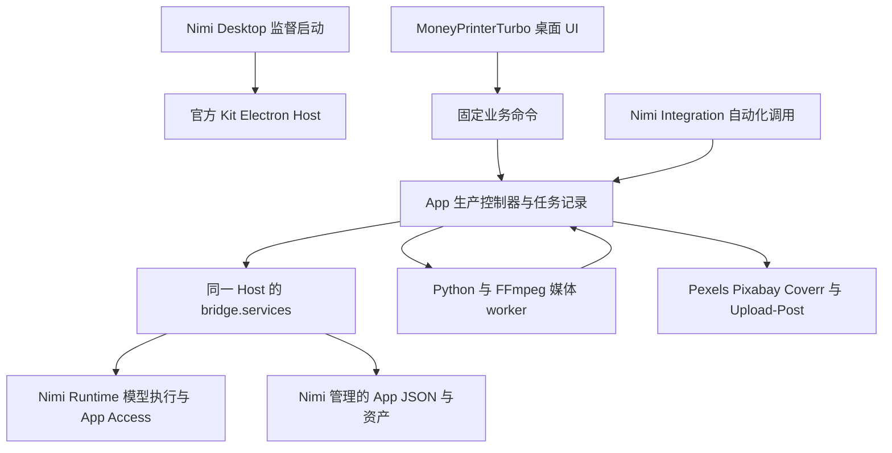

# MoneyPrinterTurbo Nimi 适配审计与实施方案

审计日期：2026 年 10 月 2 日。面向本 fork 的实施 worker 和后续评审。本文件是版本限定的审计与方案，不是 Nimi 产品权威，也不表示方案已经获批、功能已经实现或发布已经完成。

## 正式 Windows 包验收（2026-10-14）

0.1.0 已通过 tag 工作流发布；实际下载包 SHA-256 为 `009d8ce75ffcb0a472a9967ec143ff25b98cb87c301df6e9b7a77be07f0d1309`。通过正式 Nimi 0.2.4 Home 本地导入并启动，SDK 0.21.0 / Kit-native 0.19.3 接入正式服务。Registry PR 104 检查通过，仍等待人工准入；本节不是 Catalog 安装声明。

实际生成的脚本为“清晨河畔，柳枝轻拂水面。白鹭掠过，唤醒一河晨光。”，来自已配置的 Deepseek V4 Flash。Qwen3 TTS Flash / Cherry 完整配音预览生成并播放到 5.20 秒；新成片任务复用该预览，由本机 Whisper 生成真实逐词时间轴和两条字幕，再使用既有河畔图片合成 9:16 MP4。任务尾号 `6af1f9` 完成，播放器到达结尾；“打开文件”正式入口显示实际成片，FFprobe 核对 1080×1920、30 fps、H.264/AAC、5.20 秒、1,585,724 字节。副本保留在 `.nimi/local/acceptance/release-0.1.0-final.mp4`。正常退出后从 Home 重开，完成记录、配音预览、字幕和视频均保留，失败/暂停记录没有自动重放。

本次保留的限制：MiMo Flash 的脚本请求返回 `ai-provider-rate-limited`，原无 ID 请求保持不确定状态，“显式继续”拒绝重放；没有将新 Deepseek 任务算作 MiMo 通过。本机 VoxCPM2 当前返回未配置，未重新准备环境。Qwen Audio 3.0 TTS Plus 的默认声音请求被拒绝（Job `01M4X002G9WDDC2YW3Q41G8VZS`）；公开 preset 列表提供的 `User Custom Voice` 也被拒绝（Job `01M4X0A0DQ4YHDR542QN7K88W7`）。目录中的 `user-custom` 是动态声音占位项，而非实际声音，这个 Nimi 选项投影问题需由共享 owner 修复，不在 App 内硬编码过滤。没有将占位音色、声音创建、库存素材服务或 Upload-Post 标为通过；没有发布社交内容。

## 历史平台包升级（2026-10-11）

当前 checkout 使用正式 SDK 0.21.0、Kit/native 0.18.1、App Tools 0.11.4 与 Nimi Coding 0.6.5；已移除核心包本地覆盖并更新锁文件。类型检查、生产单元测试、120 个媒体测试（134 个 subtests）、renderer/Host 构建和冻结锁验证通过。reasoning-summary 不会被当成正文完成，新增回归覆盖流事件顺序。

接手后通过主仓正式 dev:runtime/dev:desktop 恢复源码环境，原开发注册已成功受监督启动。当前正式包组合已实跑本地模型脚本改写，使用原有本地图片与背景音乐生成任务 `b0da24...`（“正式包升级验收：雨后河边”），得到 3 秒、1920×1080 MP4；App 受控播放器加载至 readyState=4 并播放到结尾，无解码错误。结果在刷新后保留。实际 Runtime 重启后，App 显示连接失效，通过原 Try again 入口恢复并重新读取原任务，没有自动重放制作。该路径未使用自动配音或自动字幕，不能替代这些能力的验收；当前组合的全 AI 创作仍为 NOT-VERIFIED，下文原组合验收保留为历史证据。

## 当前实施状态（worker，2026-10-03）

下文 manager 审计是历史基线。本节记录实际交付与验收，不表示完整产品或发布已通过。

- 正式 existing adoption 保留。AGENTS managed block、lifecycle skill 和工程投影继续由 App Tools init/sync 管理。App Tools `d1f7e3bed` 修复 fresh first init 对已列 SDK/Kit 显式组合的处理，原 reference 正式 init/check 已通过，未手改 intent/lock。
- App 已实现官方 Electron Host、React/Vite 创作界面、App 生产控制器和确定性 Python/FFmpeg worker。AI、配置、资产与自动化来自同一 Host 的 services。项目保存在声明的 Nimi App storage；scratch、Host profile、持久项目分开。Python 不接收 Nimi 凭据、Runtime 地址或通用转发。
- 原 Python AI providers、Edge TTS、Whisper、Streamlit、FastAPI、裸 CLI、Docker入口及相关依赖/配置模板已硬切。README与产品操作指南已改写；Git保留历史，未新增开发skill或自动迁移。
- 当前源码环境由 Nimi 主仓 `pnpm dev:runtime`、`pnpm dev:desktop -- --cdp-port 9333` 启动。原 MPT/reference 注册均以刷新后的 selector 恢复；原10个任务完整保留，未重放队列。Desktop origin仍为1420，MPT为1450/CDP63740，reference为1439/CDP65207。Windows NimiRuntime自动服务未操作。
- 原组合已实跑9:16主题→脚本→TTS→typed words→AI图片→MP4，16:9无配音两条批量，1:1混合素材/上传配音/逐词弹跳字幕，以及脚本阶段、配音阶段、字幕校对和无新AI调用重新成片。原暂停记录`aac773...`保留。
- 新源码组合中，任务`7466377e-2569-4138-b6dd-86ebe43a6d05`实际完成主题成片：21个真实转写单位、2条字幕，输出7.866667秒、1080×1920、H.264/30fps、AAC/44.1kHz/stereo和BT.709三项标签。完整SDK资产读取、受控URL播放及FFprobe核对通过。原始文字响应和trace已保存。
- 55秒上传配音任务`5a9981b3...`完成两段STT与204条逐词字幕。原始第二段首词0.16秒在合并结果中为45.16秒，offset只添加一次。保留供应商原文字和时间，不对模型识别质量作额外保证。完整预览`782e8208...`在任务`073537e3...`复用，零新增Job，实际音频SHA和8.64秒时长完全一致。
- Host Integration 的list/create/task/asset已真实运行。任务`58959d67...`生成16:9、2秒本地成片，通过18次受权限控制的asset读取完整取回MP4，字节与现有资产SHA一致。两个任务分别在排队和渲染中由cancel停止，未产生final.mp4；媒体进程已退出。Runtime取消确认与仅停止调度分别返回。最终provider为`moneyprinterturbo.production.v1`：分页摘要最多50条，超大详情走明确失败，单次回调失败不结束其他调用或重放create。Runtime保护既存操作schema，本次用新正式target授权验收，旧开发描述保留为不可用历史，未加兼容入口。新target两页真实list调用`ic_01M3YZ8MMNE88EVS0SRCVVP3VT`、`ic_01M3YZ8MVAPKPP0F8H5VB1AZ4J`已完成；超限与回调拒绝由故障机制测试覆盖，不冒充真实产品产物。
- 共享owner `ffd316899`实现owned videoReference和独立speech identity/performance条件；Runtime-only `db87fd270`修正无真实usage时不估算。新Kit `64fec5bef`补齐renderer对speechInput的校验和请求类型，53个相关测试、Kit build及边界检查通过。完整Kit tarball通过正式overrides安装到MPT/reference，未改安装包代码或用源码directory link。
- VoxCPM2标准Windows资源已由Desktop正式准备并启用。修复App的canonical音频准备顺序后，任务`0a8ff3ed-010a-49d9-8789-58a81a2dd24a`使用不同的身份音频、演绎音频及其准确逐字稿，经真实Job `01M3YW8M3BRMWKFWMXPPRS4DVK`得到6.72秒配音与1080×1080成片。完整资产消费、带声播放、H.264/AAC和BT.709核对通过；没有用voice.create代替演绎。任务`8a96b3b4...`真实完成30字试听，7.84秒原音频已消费。此结果证明条件实际进入模型与成片，不额外声称主观音色质量。
- 本地改写/关键词任务`834cab29...`保留模型实际逗号分隔短语，修复解析后复用原文字响应完成terms阶段，未重新推理。Nomic素材排序任务`bff4edaf...`保存实际embedding space、trace和分数，完成materials阶段。
- 配置变更任务`6edea612...`在文字执行中修改AIConfig后暂停；原文字响应保存，未迟到写入业务脚本。Host中断任务`be8ffb33...`重开后保留无ID不确定提交，拒绝直接重放。Runtime真实退出使MPT失去会话，正在渲染的`fe26994e...`与排队的`35790f25...`停止；媒体进程退出，技术重连后二者仍暂停，未产出最终视频或自动排队。
- 本地配乐任务`2bc90ed2...`的真实消费暴露3秒画面/179.99秒音轨错误，原坏产物保留。修正最终音轨边界及显式循环策略后，`aecfab7c-24b5-421f-873b-c3ba634be16e`复用原素材重新成片，无AI Job；完整资产、FFprobe确认视频与音轨均3秒、BT.709和非静音混音。长配乐截断、短本地音乐循环有真实MoviePy音频回归。
- 新v1 provider的真实create调用`ic_01M3YZHX2M96NRE28P5GWG9NYJ`产生`cd4d12b6...`/`cdb92222...`两条批量：1:1、2秒、contain、1.25倍速、FadeIn、本地短配乐循环。通过task及asset真实回调完整取回两份MP4并核对原资产SHA；实际播放无错误，FFprobe确认1080×1080、音画各2秒及BT.709，1.2–1.7秒仍有配乐声（源音乐仅1秒）。两个任务均无AI Job；单素材同参数的两份输出相同，不声称模型创造了不同内容。
- 界面明确创作/业务/AI保存范围，首屏提供实际制作动作和输出范围。CDP实际保存测试确认互不覆盖，测试后恢复原设置；导航不残留创作提示。四个1166×743桌面状态完成一次修复后的界面复核；该结论不扩展为模型、安装或发布通过。
- 实际加载的source native由正式Desktop prepare编译，hash以9870a969开头。Runtime使用主仓正式`dev:runtime`入口，并在失效会话验收中通过同一入口重启；主仓当前共享修复截止`64fec5bef`。这套源码开发环境与归档service candidate e966是不同profile/构建，不以相同版本号声称同源二进制。SDK/原native/App Tools完整tarballs仍来自ffd源码；Kit后续补丁来源单独明确。
- Windows完整媒体payload最终build与`pack --target windows-x86_64 --production`通过，产物位于`dist/nimi-app/moneyprinterturbo.studio-0.1.0-windows-x86_64.nimiapp`。实际payload内的Python3.14.4、按uv.lock哈希锁定的wheels、FFmpeg/FFprobe9.0.1和Noto字体再次渲染约9.93秒方形成片，含中文/动效字幕、配音和循环短配乐。FFprobe确认H.264/AAC、1080×1080和BT.709；视频/音轨差0.03秒，在一帧范围内。最新App check与完整test通过：10个Node规则测试、120个Python媒体测试和134个subtests；随后超限失败通道修正重跑2个Integration机制测试通过。这些只证明其覆盖行为。

本地实现和当前可运行路径已收尾，保留本地Git checkpoint；独立演绎、会话恢复、配置变更、关键词、排序与本地配乐已有上列实际结果。以下外部账户、模型费用及安装平台条件仍限制对应验收，不能据此宣布完整业务、安装或发布通过。本轮按用户要求直接继续，未向manager同步。

按用户最新费用约束：视频条件配乐缺ElevenLabs key，真实模型验收NOT-VERIFIED；不能用MiniMax普通音乐替代该任务。库存/Upload-Post账户为空，外部搜索和发布NOT-VERIFIED。新增付费AI视频/声音创建等未跑路径如实保留NOT-VERIFIED。不切换安装包环境；macOS arm64、安装/升级、Registry和公开发布未验收。未push、tag、Release、Registry提交或社交上传。

## 已确认范围与审计基线

以下各节保留2026-10-02初始化前后的历史审计语境；其中“当前/已有/缺口”指当时基线。实施后的结果与仍未验证的路径以本文件顶部“当前实施状态”和NIMI_APP.md为准，不能把历史缺口或工程初始化结果当作平台现状。

用户已确认：**以 Nimi Desktop 为主，自动化入口跟随 Host。** 不要求保留独立 Docker 服务、远程 API 和脱离 Desktop 的裸 CLI 作为最终交付形态。脚本生成、阶段产物、批量任务等自动化能力仍须保留。

本轮 manager 的授权范围是审计、规划、准备 worker prompt，以及通过 App Tools 正式初始化项目 context。为满足 adoption 的真实前置条件，准备官方生成的最小 Host/renderer 与实际工程命令；不恢复业务产品流程。未修改 Python 业务实现、Nimi 权威、SDK、Kit 或 Runtime 源码，未执行付费生成、App 安装、发布或社交平台上传。worker 的业务实施授权以用户随后实际提交的执行 prompt 为准。

| 对象 | 审计时身份 | 证据范围 |
| --- | --- | --- |
| 目标 fork | `D:/nimi-realm/nimi-apps/third-party/MoneyPrinterTurbo`；分支 `nimi`；origin 为 `https://github.com/nimiplatform/MoneyPrinterTurbo.git`；HEAD `e053af00af427f146413aa45f59a0ade709bde93` | 开始审计时工作树干净；Python 项目版本 `1.3.7`，MIT；没有 Nimi manifest、Node package、Electron Host 或 AGENTS |
| 上游来源 | `https://github.com/harry0703/MoneyPrinterTurbo` | fork 关系与上游 product skill 声明；上述 SHA 是本次本地审计基线，不声称它始终等于上游最新提交 |
| 参考 App | OpenMontage HEAD `cae4c82a8ffbfb2075f4fcfb30b9a963568c6eb7`；分支 `nimi` | 检查了 Host、媒体 worker、生成和转写 consumer；没有重新运行其历史验收 |
| Nimi 源码 | `D:/nimi-realm/nimi`；HEAD `74123bbd2fff1ccef4b8029dacd79e93b3659253`；分支 `main`，当时领先 origin/main 12 个提交 | 审计开始时的源码和声明；初始化阶段随后从该 SHA 构建 SDK、Kit、Windows native 和 App Tools；没有构建或验证同源 Runtime/Desktop 运行组合 |
| 工具环境 | Node `24.15.0`；pnpm `10.34.5`；本机 Python `3.14.4` | 只读取版本；目标项目声明 Python >= 3.11，`.python-version` 为 3.11 |

后续仅在依赖输入发生变化、出现矛盾或原证据未覆盖决策时重查相关结论，不重开整个审计。初始化准备期间 Nimi 主工作树出现涉及 SDK、Kit/native、Runtime 和 authority 的并行修改，故采用固定上述 SHA 的隔离 checkout 准备基础包；保留主工作树修改，worker 进入共享 owner 时应按当时状态复核相关假设。

## 现有产品与实际调用链

`webui/Main.py` 的 Streamlit 界面、`cli.py` 和 `app/controllers/v1/*` 的 FastAPI 入口最终使用 `app/services/task.py` 的共享流水线。主要顺序是脚本、素材关键词、配音、字幕、素材、媒体拼接与最终成片，然后按配置独立提交跨平台发布。`stop_at` 支持 `script`、`terms`、`audio`、`subtitle`、`materials`、`video`。

本地图片/视频、自定义脚本、自定义配音、无配音、音色试听与预览复用、句级/逐词字幕、字幕动效与样式、批量变体、任务历史与设置恢复都属于须恢复的产品行为。分辨率是竖屏 1080×1920、横屏 1920×1080、方形 1080×1080；不能继承 OpenMontage 的 1280×720 成片约束。

AI 调用目前散布在 `llm.py`、`voice.py`、`subtitle.py`、`material.py`、各视频供应商模块、`sonilo.py`、`elevenlabs_music.py` 与可选 `twelvelabs.py`。全局 TOML 配置混合保存业务设置和供应商凭据；WebUI 生成期间用配置锁维持一致性。WebUI 有独立内存队列，API 可选择内存或 Redis。磁盘产物和历史依赖仓库附近的 `storage` 路径。

这不是只替换一个 LLM URL 的项目。接入须同时处理配置 ownership、受保护调用、原始媒体与派生产物、业务任务生命周期以及 Python 子进程的真实安装与退出。

## 推荐产品形态与所有权

推荐 **React/Vite 桌面产品界面 + 官方 Electron Host + App 自有 TypeScript 生产控制器 + Python 媒体 worker**。这是局部重组：保留可复用的 Python 媒体算法与非 AI 服务，重做桌面 consumer 和底座接线，不重写整个媒体引擎。Streamlit 的控件和全局配置写法不作为 Nimi 接线的承载层。

选择 TypeScript Host 的依据是当前活跃的 SDK/Kit Local App carrier，而不是 Python 语言本身不适合媒体。Python/Go/Rust SDK 目前仍是生成的 Runtime/Realm core；原 Python 服务不能仅增加 appId 或直接 gRPC client 就取得受保护 App 的 AI/storage 能力。



| 所有者 | 保留责任 |
| --- | --- |
| MoneyPrinterTurbo | 创作参数、提示词、脚本审核与编辑、素材搜索与匹配、阶段编排、批量队列、字幕组装与校对、混音/编码、项目历史、业务服务账户、发布选择 |
| Nimi AIConfig 与 Runtime | 已提交的 Local/Cloud 路由意图、模型与资源选择、AI 凭据、模型执行、单次 Job、受保护 App session 与 App Access |
| SDK/Kit | 正式 Local App client、Host/preload/renderer carrier、配置 UI、受保护服务与资产预览 |
| App Tools | 工程接入、固定 lifecycle skill 与独立 managed AGENTS block、声明同步、检查、开发启动、构建与打包编排 |
| 外部 coding host | 开发任务协调、跨仓修改授权与完成判断；不下放给 Runtime 或 App Tools |

Nimi 平台身份不是 Upload-Post、素材服务或 GitHub 的登录凭据。Python 不接收 Nimi token、session material、Runtime 地址或通用受保护转发口。固定媒体操作可使用 UTF-8 stdio 和受控文件工作区；stdout 留给协议，诊断写 stderr，进程及其子进程由 Host 管理。

## 需求与 Nimi 能力映射

下表的“已有”表示检查到公开 carrier、准入/执行路径或支持说明，**不表示本机真实调用已经验收**。E 编号对应文末直接证据。

| 消费者与激活条件 | 必须得到的结果 | 可用路径与模式 | 分类与拟改动所有者 | 证据 |
| --- | --- | --- | --- | --- |
| 自动脚本、关键词、社交文案；手工输入时跳过相应步骤 | 完整文字或经过 App 校验的结构化结果 | Host `services.ai` 的 text candidate/Local App text model；SYNC 或 STREAM | 已有能力；App 迁移提示词与解析。完整 terminal 后才保存，不把错误字符串当文案 | E1 E3 E5 |
| 素材关键词按主题重排；原 TwelveLabs rerank 开启时 | 同一 embedding space 的向量与相关性排序 | `ai.scenario.execute({ type: 'text-embed', inputs })`，SYNC | 已有能力；App 批处理与相似度排序。不固定 512 维，不混合不同 spaceId | E2 E5 |
| Pexels/Pixabay/Coverr 与本地素材 | 可用文件、实际时长、来源信息与素材顺序 | App 非 AI 搜索/下载与媒体操作 | App-owned；保留业务密钥、缓存、来源、画幅筛选与批量分配，不能全部搬入 Runtime | E1 E4 |
| AI 图片素材 | 图片资产，随后按业务规则生成动态片段 | `image-generate` Scenario Job，ASYNC_JOB；资产 adopt/read | 已有能力；App 保留动态图片渲染。生成图片尺寸与最终视频画布分开处理 | E2 E3 E5 |
| AI 视频素材；原各供应商模式 | 可解码视频及真实长度、结果记录 | `video-generate`，ASYNC_JOB；实际资源支持的 t2v/i2v 与 options | 通用能力已有；App 移除供应商路由。特定模型、分辨率、时长、音轨或 reference 组合须核对实际 Driver，不能保证旧供应商全部等价 | E1 E2 E5 |
| 自动配音、试听、完整预览复用 | 可播放音频、真实时长、所用 voice identity | `speech-synthesize`，ASYNC_JOB；`voiceAssets.list` 与 AIConfig 当前资源；可用 STREAM 另按场景选用 | 已有能力；App 把供应商编码音色改为公开 preset/voice-asset 引用。速度等参数按资源支持或明确的本地后处理保留 | E2 E3 E6 |
| 上传配音或无配音 | 原音频或明确业务时长的静音轨，供后续合成 | Python/FFmpeg 确定性处理 | App-owned；不强制调用 TTS，不用模型完成标记包装本地音轨 | E1 |
| 自动句级/逐词字幕、上传配音字幕 | 实际音频时间轴上的文字与 cues | `speech-transcribe`，ASYNC_JOB；`timestamps: true`；读取 `job.transcription.words` | 已有带对齐资源；App 负责分块、offset、断句、校对与 SRT。普通无时间戳转写不够，不能均分时长伪造逐词时间 | E1 E3 E5 E6 |
| 参考音频克隆与参考逐字稿 | 可用于后续合成的真实 voice asset | `voice-create`，ASYNC_JOB；资源声明 `referenceAudioInput`；随后 TTS | 通用声音克隆已有且资源相关。保留引用与试听工作流、素材临时性；不能把创建成功等同于合成成功 | E3 E6 |
| VoxCPM 独立节奏/情绪示范音频与 prompt_text | 除身份参考外，独立演绎条件实际进入合成 | 当前 Local App TTS 输入无独立该音频/逐字稿对；本地 VoxCPM Driver 还只接受默认声音 | 条件性公开输入/Driver 缺口；由共享 owner 决定现有合成契约与投影扩展。通用 Qwen 克隆不能证明此特性完成 | E2 E7 |
| 随机/上传/本地背景音乐与音量 | 正确时长与音量的混音轨 | Python 媒体操作与 App 资产 | App-owned；0 音量和关闭时跳过生成。内置歌曲须确认再分发依据 | E1 E4 |
| 普通 AI 纯音乐配乐 | 可播放音乐及真实结束/长度 | `music-generate`，ASYNC_JOB；资源 `musicInput`；`instrumental: true` 与空 lyrics 等真实支持输入 | 已有通用能力；App 消费 `musicGeneration.mixArtifactId/audioInfo/termination`。它不是原视频条件配乐的等价替代 | E2 E3 E5 |
| 原 Sonilo/ElevenLabs“按成片画面配乐”选项 | 实际成片视频作为条件的配乐 | 当前 Local App music 输入是 prompt/lyrics/score/audioReference，没有 videoReference | 条件性语义/公开 carrier/Driver 缺口；共享 music owner 评估视频条件输入。不能只提交脚本摘要后宣称恢复此功能 | E2 E4 E5 |
| 合成、批量、阶段结果、历史与设置恢复 | 三种画幅 MP4、字幕/配音/素材等中间产物、可恢复记录 | App 控制器 + Python；`services.storage.json/assets` | App-owned；保留能力，重新组织单一任务控制器与每任务输入快照，摆脱进程全局配置锁 | E1 E3 |
| Agent/CLI/API 所承载的自动化需求 | 发起生产、查询任务、读取阶段结果、取消、取回成片 | 当前 `services.integration` 的 registerProvider/pollProvider/completeProvider；App 自有任务 ID | 共享载体已有；App 定义有界 operation/schema，声明 `integration.provide`，Home 管理连接/权限。模型推理无需转给 agentWork | E3 E8 |
| Upload-Post 手工/自动发布选项 | 对具体平台真实提交结果，与成片状态分开 | App 非 AI 服务；文案生成仍经 Nimi | App-owned；业务账户与上传回执保留。用户明确启用/确认后才能真实上传，本轮未上传 | E1 E4 |

`TwelveLabs.analyze_clip` 在检查的 product consumers 中没有实际调用点，不能仅因 helper 存在就把视频问答算成必需能力。将来启用该任务时再核对视频理解所需的公开输入和精确模型支持。LoomLoom 等旧外部工作流不作为 Nimi 底座继续保留；其可观察的素材选择、生成参数与产物任务须由 App 编排恢复，供应商后台的 marketplace/endpoint/token 控制不是原样保留的产品目标。

## 核心通过条件与功能缺口

核心通过条件是选定并真实运行匹配的 Desktop、Runtime、SDK、Kit/native 与 App Tools 组合，同时在 AIConfig 中配置任务所需能力。基础路径不依赖新 CapabilityContract，不能把环境尚未配置解释成能力不存在。当前 SDK 0.19 / Kit 0.16 的 fresh reference 初始化准入需要工具 owner 处理，详见 context 结果；它阻塞同组合 reference baseline，不推翻已有 AI 能力的源码证据。

**完整功能覆盖尚未通过。** 视频条件配乐和独立演绎参考音频的输入缺口已由源码确认；它们只阻塞对应选项，不阻塞库存/本地素材、普通配音、真实转写字幕、动态图片和一般 AI 视频路径。特定旧供应商行为属于组合核对事项，未检查的组合是 unknown，不列为“缺失”。

共享扩展先明确请求/结果语义：已有任务的输入条件尽量归入该契约；独立生命周期或结果语义确实需要时才新增 CapabilityContract。Runtime/Driver、proto、SDK、Kit/native、配置资源投影和 App consumer 必须一起完成。App 不增加 AI REST 旁路或私有本地模型服务。

若未来实施明确限定“不得扩展 Nimi”，应报告上述选项未满足，完整迁移不得宣称完成；任何删减这些已列产品能力的决定须明确记录，不能由 worker 隐式降级。

## 版本选择与 OpenMontage 复用

建议本次开发选用审计源码 cohort：**App Tools 0.11.4、SDK ^0.19.0、Kit ^0.16.0、对应原生 npm carrier 0.16.0 / Rust carrier 0.8.0、nimi-coding 0.6.3，以及同源构建的匹配 Runtime/Desktop。** App Tools 的 additional dependency combination 明确接纳 SDK ^0.19.0 × Kit ^0.16.0；fresh 默认声明仍是 SDK ^0.18.1 × Kit ^0.15.3，不能把默认数字误认为已发布且能解决本次全部需求。

本机 `pnpm view ... version --json` 返回 app-tools latest 0.7.5、SDK 0.15.0、Kit 0.11.0。SDK migration notes 同时说明 0.16–0.18.1 属于未上 npm 的开发编号。因此，上述建议 cohort 当前按**源码开发组合**准备完整 npm tarball 与 native，不能直接假设从 registry 安装即可；latest 查询也不证明某个 next/staged 精确版本不存在。发布前重新核对当时真实 registry 解析。

本轮初始化已从固定 SHA 构建并安装 App Tools 0.11.4、SDK 0.19.0、Kit 0.16.0 与 Windows native 0.16.0 tarball，保存在本 App `.nimi/local/platform-packages/`，pnpm lock 固定归档完整性。native 使用官方 `windows-source-local-development` 构建脚本，属于文档声明的 Windows D2 profile，不是生产 Runtime signer profile 的验收。该 cohort 的真实受保护调用仍未验收。

目标 App 和 reference 都使用独立的单包 pnpm workspace、显式 tarball overrides 和 lockfile；生产依赖不得指向 Nimi 源码目录。native 保持 Kit-owned，不作为 App 自行选择的载体。记录必要的 source SHA、归档来源与锁身份即可，不新增 receipt/manifest 证明体系。

OpenMontage 可以复用的思路包括 Python 媒体算法封装、子进程资源管理、阶段产物保存和任务状态消费。不能照搬的内容包括：

- 旧 Host 没有当前要求的第一步 `configureNimiElectronAppHostProfile(app)` 和新 session invalidation wiring；应使用同版本工具生成的 Host。
- 旧转写 consumer 只读 `transcriptionText`，示例音频 bytes 使用 `number[]`；当前应消费 typed words，media bytes 使用 `Uint8Array`。
- 旧任务不确定提交策略没有等同于所有操作持久恢复。本次须按具体 Job 的实际恢复能力设计。
- `NIMI_APP.md` 内 app-tools 0.5.3 与 package.json 的 ^0.7.5 不一致；SDK ^0.12.0 / Kit ^0.8.0 也不是本次推荐组合。
- 其 720p 输出、工作流目录和曾验证的切片不能覆盖 MoneyPrinterTurbo 的画幅、字幕动效、库存素材、批量或发布能力；不修改参考仓来满足本任务。

## 任务、配置与资产设计

建议将 App 代码组织为 `src/` 产品 UI、`src-electron/` 官方 Host 与固定业务命令、`src/production/` 或 App 自有等价目录的控制器，以及 `app/` 下可复用的媒体算法和非 AI 服务。目录名是建议，不建立新的 Nimi 产品真相。

控制器保存原始创作参数、每阶段输入快照、配置 revision、App task ID、已知 Nimi Job ID、真实结果与失败原因，调度下一个阶段前检查 scope 和用户停止意图。脚本、音频、素材、字幕或设置改变时，明确作废实际受影响的下游结果；已完成且仍适用的结果可复用，避免重付费。

**恢复能力不得泛化。** 当前 `clientSubmissionId` / `lookupSubmission` 的持久恢复适用于 music-generate、music-transcribe、audio-voice-convert；Runtime `captureLocalAppMusicSubmission` 会拒绝把该 ID 用于图像、视频、TTS、STT 或 voice-create。普通 Job 保存已知 ID 并尝试查询原任务；拿不到 ID 的不确定提交保持暂停，不盲目重发。不得保证普通 Job 跨 Runtime 重启恢复；已采用到 App storage 的结果用于长期重开。音乐恢复窗口为当前文档的 24 小时，不能作为长期资产保存。

AIConfig 保存并提供路由、资源与模型选择，App 保存业务参数。旧供应商 key/base_url/model 配置和明文 Key 导入/导出退出 Nimi AI 路径；素材和 Upload-Post 的业务配置可以保留其真实需要。参数不支持时说明具体限制；音量、播放速度等可以在产品语义允许时由明确的确定性后处理实现，不能装成模型接受了参数。

项目 JSON、历史、用户设置与需保留媒体进入 Nimi App storage。Host 将输入流入隔离 scratch，Python 只得到具体 workspace 和允许的媒体操作，处理完成后 Host 验证并写回资产。大型视频使用流和 asset media URL，避免把整段视频变成 renderer 的 JSON 数组或完整 Blob。以 `adoptArtifact` 返回的实际 relativePath 为准；媒体类型、实际签名、完整字节接收与 ffprobe 结果分别处理。

Python 现有 `utils.root_dir()/storage` 和 config.toml 路径需要调整，不能在安装包目录里持久写项目。开发与安装的 Host profile 不等于持久 App 资产；不能依靠 localStorage 的偶然位置来承诺跨入口保留数据。项目导出/导入提供明确的数据转移入口。

session invalidation 必须同步使旧任务和回调不可用、停止调度、取消在途工作、处理子进程退出并忽略迟到写入。技术 session 恢复后只恢复技术可用性，业务任务由用户或新的明确自动化调用继续，不能重放队列。App“停止”等待与 Runtime/媒体进程“确实取消”分别显示。

## 实施顺序与阶段验收

| 阶段 | 工作与依赖 | 退出条件 |
| --- | --- | --- |
| P0 固定输入 | 读取本次四个 context 文件；确认相关 SHA/版本仍适用；准备同源完整 tarball；明确 App identity、实际输出目标与命令 | 版本与包来源可复现，未用源码链接；没有把规划当完成 |
| P1 真实 Host 与正式 adoption | 正式 adoption/check 已完成。先解决所选 cohort 的 fresh reference 准入限制，再核对同组合 reference 的真实受保护路径，复用已生成的 Host/renderer 和实际工程输入 | 实际受监督 reference 与 App 基础路径通过。工具生成工作台仅是基础 |
| P2 基础成片 | App 控制器接入脚本、普通 TTS、带时间戳 STT、库存/本地素材与原 Python 编码；实现手工脚本/上传音频/无配音分支 | 从主题得到真实成片；检查音画、字幕、时长和三种画幅；手工路径跳过不需要的 AI |
| P3 产品完整性 | 恢复图片/视频素材、逐词/句级字幕与动效、预览复用、过渡/速度/fit、批量/stop_at、历史/设置与重新生成 | 对应真实用户任务完成，中间产物可读，错误与部分失败可理解，重开保留真实结果 |
| P4 条件性共享扩展 | 对视频条件配乐、独立演绎参考与实际选定的精确视频组合进入 Nimi owner；按 authority 流程设计、实现、交付完整包，再回到原输入 | 选定特性实际进入模型并被产品消费；只完成共享回归不等于 App 验收。此阶段可与独立 App 工作交错 |
| P5 Host 自动化与业务服务 | 提供固定 Integration operations，复用同一控制器；恢复 Upload-Post 业务设置、发布文案和独立发布状态 | 同一 Host 完成自动化任务和取回结果；权限在 owner 管理。真实对外上传待用户明确授权，未跑则 NOT-VERIFIED |
| P6 安装与交付 | Windows x86_64 先验收；推荐后续 macOS arm64；打包 Python、精简依赖、FFmpeg/FFprobe、字体及可再分发资源 | 真实 package build/pack、安装后媒体 worker 与受保护 Access、重启/取消/数据保留分别验收；另一 OS 未跑则 NOT-VERIFIED |

实施初期可以保留尚未迁完的源文件用于分析；正式 Nimi 产品入口只能走选定新底座。最终删除旧 AI provider、Edge/Whisper 私有推理与供应商工作流执行路径，清理不再需要的依赖和 active 文档入口，不保留 dual path、自动回退或兼容配置读法。历史归 Git；本机残留如确需处理，使用一次性工具，不产品化迁移。

## 工程检查与真实验收

纯审计阶段运行了版本查询、Git 只读检查、完整 authority context 查询和初始 App Tools adoption dry-run。后续初始化还运行了固定源码包构建、依赖安装、正式 adoption、sync/check、renderer 与 Electron Host build；没有运行产品、媒体生成、Python 测试或付费请求。以下是 worker 的验收任务，不是本轮产品结果。

- 先读真实 package manifest 后选择命令。Python 现有 CI 使用 `uv sync --frozen`、compileall、ruff、coverage/pytest；它的 AI mock 测试只支持相应单元行为。新增 Host 的工程命令必须真实实现，正式 App 用 `nimi-app check/test/dev/build/pack`。
- 从 Desktop 监督启动准确的 MoneyPrinterTurbo Host；CDP 只连接该 App 的 loopback development target。直接 Vite、Streamlit、reference 或 OpenMontage 的窗口不能代替验收。
- 运行主题→脚本→配音→真实时间轴字幕→库存/本地素材→MP4，并打开/播放成片；确认内容与时间轴，ffprobe 检查容器、尺寸、帧率、音轨与时长。保留近期 upstream 的空字幕不发布与 BT.709 编码回归。
- 分别运行手工脚本、上传配音、无配音、图片和视频混合素材、句级/逐词字幕与动效、三种画幅，以及批量两条与各 stop_at。仅需把有影响的组合运行充分，不做无决策价值的全排列。
- 分别运行真实 AI 图像、视频、声音克隆、普通音乐，以及选定且已修复的条件性选项；按 Job terminal 与实际资产检查，不以目录项或方法名验收。
- 覆盖取消、失效 session、配置改变、不确定提交、子进程退出、读写失败与任务重开；确认不会重复付费、跨 scope 迟到写入或宣称取消未实际停止的工作。
- 检查打包后的中文及其他非 ASCII 参数在 Python 和最终业务产物中完整保留，媒体工具真实可用且退出无残留子进程。
- 开发可用、本地导入安装、Catalog 安装、GitHub Release 和 Registry admission 分别记录。当前只规划，不创建 PR、push、tag、Release 或 Registry 提交。

仓库 CI 目前仅在 push main/PR 等入口触发，fork 主线是 nimi；实施时调整实际 fork 的持续集成入口并保留有价值的 Python 回归。App Tools managed release workflow 与 App CI 分别遵守 owner，不能因工具生成 workflow 就宣称发布可用。

## 工作量与主要不确定性

App 剩余工作整体为**中高复杂度**。Host carrier 可复用，媒体算法有现有实现；主要成本在将 370 KB 左右的 Streamlit 主文件恢复为桌面产品、替换跨多个模块的 AI 调用、把全局配置/磁盘状态改为每任务快照与受保护资产，以及真实跨平台媒体包。

| 工作部分 | 相对投入 | 主要决定因素 |
| --- | --- | --- |
| manager context 与工具接入 | 小到中，reference owner 修复另计 | existing adoption 与包准备已完成；当前 fresh reference 的版本准入限制还需解决 |
| 核心生成、字幕与 Python 消费 | 中 | 配置资源与实际音频对齐质量、媒体桥接和原算法复用 |
| 完整 UI、设置、批量、历史与自动化 | 中到大 | 原行为覆盖，而非供应商表单数量；同一控制器复用程度 |
| 视频条件音乐与独立演绎输入扩展 | 高且有不确定性 | canonical 契约决定、选定 Driver 的真实协议与模型支持、完整公开投影 |
| 双平台媒体包与安装验收 | 中到大 | Python wheels、FFmpeg 与字体、native 信任/版本、实际测试机器 |
| 指定旧供应商全部行为等价 | 另计增量 | 不属于默认进入成本；具体 option 被选定后逐项确认 |

没有记录可比项目的真实工时和本机完整运行基线，不给精确人周或 AI session 数承诺。先完成 P1/P2，会收敛 Host、包交付和媒体桥接不确定性；P4 逐个选定行为评估，不把所有 upstream provider 分支加成统一 blocker。

可复用的平台收益是视频条件音乐、受控演绎参考输入及必要的 typed carrier/Driver 修复；字幕规则、批量任务、素材匹配和视频合成不升级为 Runtime 工作流。

## manager 初始化阶段历史与正式门槛

用户明确要求 skill 直接由 App Tools 初始化产生；不创建自定义 skill。项目 context 由工具生成的 `.agents/skills/nimi-app-lifecycle/` 和独立 AGENTS managed block 承载；本方案与 `NIMI_WORKER_PROMPT.md` 只是审计和交接文档，不是产品 spec。

最初的只读预检因为缺少真实工程输入失败，实际执行了：

```powershell
# 在 Nimi 源码根运行；只读预检，用的是已审计源码里的官方 CLI
node app-tools/bin/nimi-app.mjs init --adopt --dir D:/nimi-realm/nimi-apps/third-party/MoneyPrinterTurbo --dry-run --json
```

返回 `ok: false`：`Existing submitted app requires nimi.app.yaml. Prepare the real App-owned Host and build/test inputs ...`。源码进一步要求真实 package.json、非递归 test/build command 和 `build:electron`。因此正式初始化使用官方生成的真实 Host/renderer/build source，并把已有 Python 测试接为实际 test owner，不使用占位命令伪装已接入。

官方 [adapt guide](../../../nimi/app-tools/skills/nimi-app-lifecycle/references/adapt.md) 要求：`Prepare the existing App's actual pnpm/Electron Host, renderer and test/production-build commands from that integration.` P-SCAF-018d 则规定固定 lifecycle skill 与 managed AGENTS block 只经显式 init/sync 投影。因此不手抄 managed block，不直接调用包内部投影函数绕过 adoption，不把技能文件复制称为官方初始化。

正式初始化读取所选已安装包的 lifecycle skill，执行 `pnpm exec nimi-app init --adopt --input .nimi/local/adopt-input.json --dry-run --json`，检查范围与碰撞，再执行正式 init。输入仅包含缺失的 `manifest` / `build_profile`，必须与已有声明一致。初始化使用 `moneyprinterturbo.studio`、独立 Nimi App version 0.1.0，不使用 upstream Python 1.3.7 冒充 Nimi App 发布版本。

**正式 init 已完成**，生成 App Tools skill 与独立 AGENTS block，并通过 project-local nimi-coding 生成其 own managed block 与 methodology。App 根没有 fresh scaffold intent/lock；没有自定义 skill。`check` 的 `managed: false` 表示 existing-App adoption，不表示这些指导块没有工具 owner。

| 本轮实际执行 | 结果与边界 |
| --- | --- |
| 固定 SHA 的 SDK/Kit/App Tools 与 Windows native 构建、完整 npm pack | 成功；归档在 `.nimi/local/platform-packages/`。Runtime/Desktop 未同源构建或运行，macOS native 未构建 |
| `pnpm install` 与 frozen-lockfile install | 成功；根依赖已安装，`postinstall: install-electron --no` 成功，实际 Electron exe 存在。未启动 App |
| `pnpm exec nimi-app init --adopt --input .nimi/local/adopt-input.json --dry-run --json` | 成功；检查了实际文件变更、existing dependency combination 与 owner step |
| 同命令移除 dry-run，执行正式 init | 成功；skill 和 managed blocks 均经工具生成，不手工复制 |
| `pnpm run sync`、`pnpm exec nimi-app check --json` | 成功；existing source 检查通过，nimi-coding managed projections in sync；仅声明 Windows x86_64；safety_profile 尚未声明 |
| `pnpm run build` | 成功；包含 renderer TypeScript 检查与 Vite 实际构建。参考工作台存在大 chunk 警告，不是视频产品验收 |
| `pnpm run build:electron` | 成功；生成真实 `dist-electron/main.js` 与 preload。未做整个 production payload、Python bundle、build/pack 或安装 |
| 同组合 `.nimi/local/reference` 的 create、依赖安装、fresh init | create/安装成功，**fresh init 失败**：`package.json dependencies.@nimiplatform/sdk must be ^0.18.1`。不可将其视为可运行 baseline |
| Python `test:app`、Desktop-supervised App、真实 AI、媒体与安装 | **NOT-VERIFIED**。Python test owner 连接现有真实 pytest suite，但本轮没有安装或运行 Python 测试 |

reference 的实际失败说明：App Tools 0.11.4 在 existing adoption/check 接纳 ^0.19.0 × ^0.16.0，但 fresh intent 的固定默认仍要求 ^0.18.1 × ^0.15.3。不得改写 fresh intent/lock、伪报归档版本或复制另一组合的结果来绕过。worker P1 由 App Tools owner 核对并实现受支持的同组合生成/升级入口，或在当前 authority 允许的正式流程内提供等价 baseline；任何替代都必须仍使用相同 SDK/Kit/native 与真实受保护调用，不能默默降级。所选包的 reference 入口在 `.nimi/local/reference/`，保留了失败状态与真实 lock，尚未完成 init。

当前 source/tool 编号不会因为该 reference 失败被擅自降级；条件性 AI 功能和独立媒体恢复工作可以继续。正式 Nimi App 的业务接线与完成判断仍需要成功的匹配 baseline 和真实旅程。

本轮声明中的 icon 指向待补的 App artwork；portable App info、真实 safety/support facts、macOS target 与媒体 production payload 由 worker 在第一个需要它们的 owner 入口前补齐，包括有关开发注册和 production/pack 阶段。普通 check 不验证这些发布事实，不作为生产 preflight 成功。local package 是本机开发输入，新的机器需重建/交付同一归档或重新选择合法 registry 组合。

固定 SHA 的隔离 checkout 完成包准备后尝试归档，工具因 pinned task/workspace 保护拒绝；最初准备目录的递归清理也被工具策略拒绝。二者保留，不继续尝试绕过；worker 仅使用本 App 记录的归档与 reference，不混用最初临时目录里的包。

## 直接证据入口

以下均以本报告基线为限。路径相对目标 App，外仓入口按已给定拓扑引用；实施时进入对应仓库遵守其 AGENTS chain。

- **E1 App 任务与结果**：`app/services/task.py:1465` `_run_pipeline`；`:513` `generate_audio`；`:611` `generate_subtitle`；`:939` `generate_final_videos`；`app/models/schema.py:113` `VideoParams`；`cli.py:1717`；`webui/Main.py`；`app/controllers/v1/video.py`。
- **E2 公开请求与准入**：`../../../nimi/sdks/typescript/core/app/local-app-runtime-platform-ai.ts:152` / `:446`；`../../../nimi/proto/runtime/v1/ai.proto:1253`；`../../../nimi/runtime/internal/services/ai/scenario_validation.go:24`；`local_app_scenario.go:173`；`local_app_scenario_job.go:38`。
- **E3 正式 carrier 与支持边界**：`../../../nimi/sdks/typescript/README.md:14` / `:73` / `:199`；`CHANGELOG.md:11`；`../../../nimi/kit/shell/electron/README.md:74`；`../../../nimi/app-tools/lib/app-scaffold-profiles.mjs:1279`。
- **E4 非 AI 与视频条件配乐**：`app/services/material.py:338` / `:439` / `:580`；`app/services/sonilo.py:330`；`app/services/elevenlabs_music.py:17` 及视频 proxy/request；`app/services/upload_post.py`；`README.md:490` 内置音乐来源说明。
- **E5 dispatch 与音乐语义**：`../../../nimi/runtime/internal/services/ai/scenario_local_speech_job.go`；`scenario_local_music_job.go`；`scenario_media_execution.go`；`../../../nimi/sdks/typescript/core/app/local-app-music.ts:11`；`../../../nimi/runtime/internal/services/ai/local_app_music_submission.go:46`。
- **E6 字幕与通用声音克隆**：`../../../nimi/sdks/typescript/README.md:73`–`142` 的 typed words、aligned recipes 与输入限制，`:199` 起的 voice-create 与资源 input 能力；普通转写/创建都不保证所选模型内容质量。
- **E7 独立演绎缺口**：`app/services/voice.py:2961` 附近 VoxCPM reference/prompt_audio/prompt_text；`../../../nimi/sdks/typescript/core/app/local-app-runtime-platform-ai.ts:176` TTS 闭集；`../../../nimi/runtime/internal/capabilitydriver/voxcpm_speech.go:260` 明确拒绝非默认 voice 和多种 synthesis options。
- **E8 自动化**：`../../../nimi/sdks/typescript/core/app/local-app-runtime-platform-integration.ts:24` 起的 provider methods、operation effect/retry/schema 校验；`../../../nimi/kit/shell/electron/README.md:74` Host services。
- **工具与当前语义**：`../../../nimi/app-tools/package.json`、`lib/app-dependency-combinations.mjs:11`、`lib/app-project-lifecycle.mjs:1371`；完整 P-ARCH-001a outgoing context 查询成功；当前 `platform/app-ecosystem.authority.yaml` 的 P-SCAF-018d，以及 `platform/governance-release.authority.yaml` 的 P-GOV-026 positioning/owner-boundary。最初以单文件进行的失败 authority 查询未用于结论。
- **参考 App**：`../OpenMontage/src-electron/main.ts`、`media-runtime.ts`、`src/production/generation.ts`、`transcription.ts`、`package.json`、`NIMI_APP.md`；其历史报告仅作为报告过的切片参考，没有本轮复验。
- **公开来源**：[nimiplatform fork](https://github.com/nimiplatform/MoneyPrinterTurbo) 确认 fork 与产品来源；具体技术结论以固定本地代码为主，公开页面不代替代码和真实 App 验收。

原 manager 审计阶段所有 MoneyPrinterTurbo 产品路径均未运行；这是历史交接边界。当前 worker 运行与未验证范围以文首当前实施状态为准。
